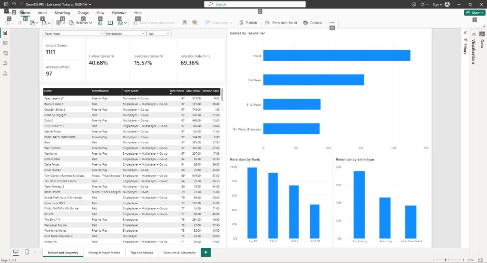
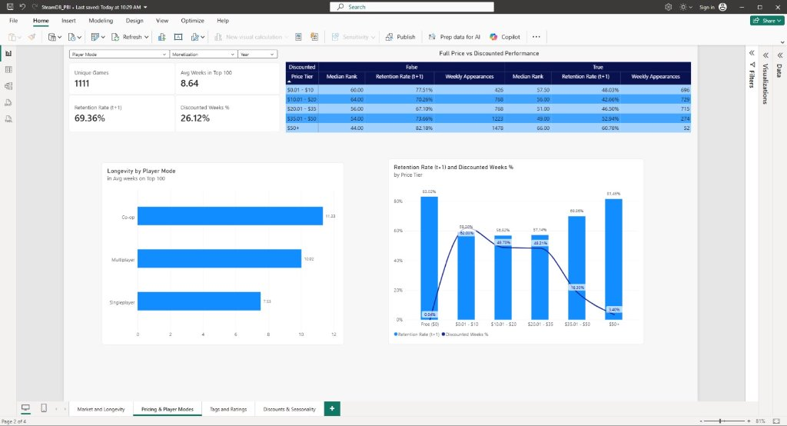
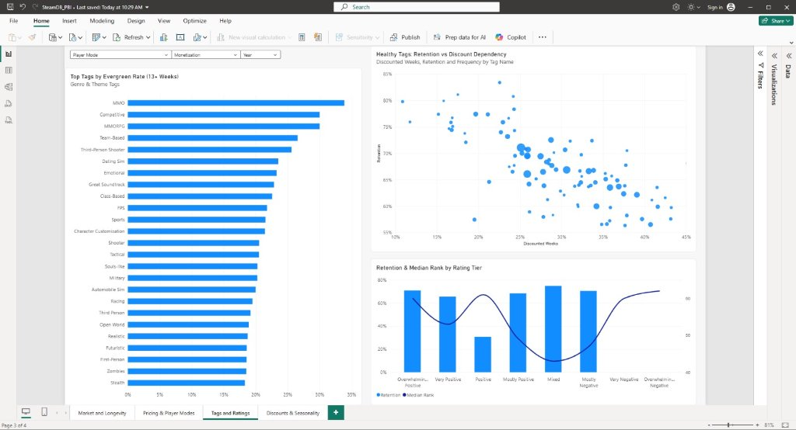
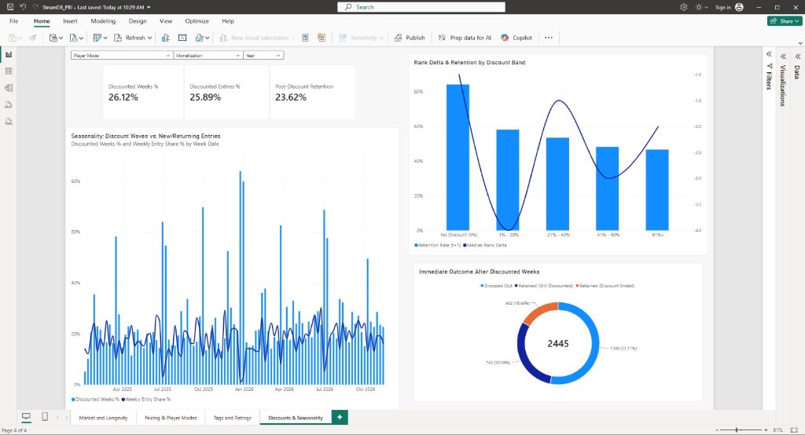
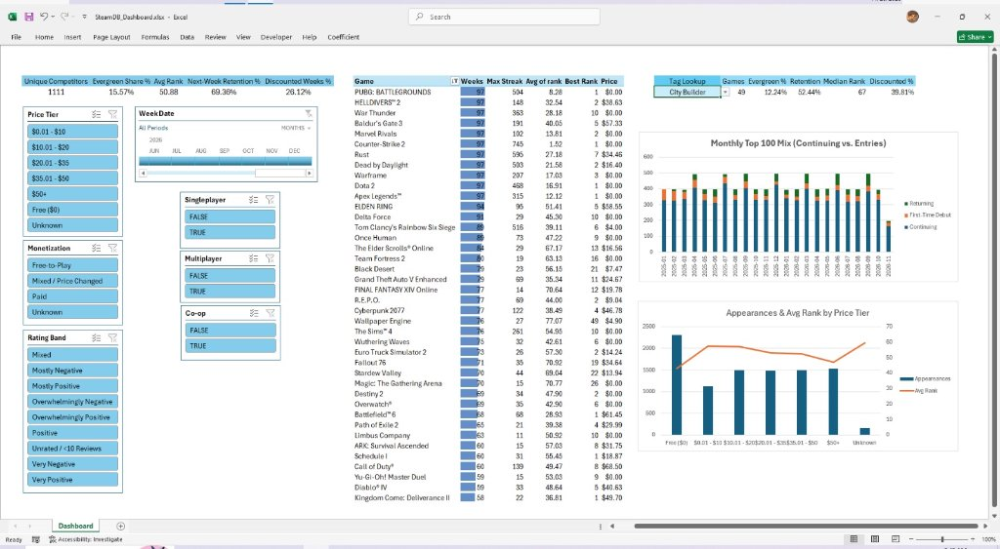

# SteamDB — Steam Top 100 ETL, PostgreSQL Analytics & BI

**SteamDB** is an end-to-end data engineering and business intelligence project built around the **Steam Global Top 100 Sellers** weekly chart.

**Business Use Case:** A game studio or publisher planning a new release wants to identify which product attributes (monetization model, price band, play modes, genres/tags, review score) and post-launch commercial levers (discount depth, seasonal timing) best explain **entry** and **long-term permanence** inside the Steam Top 100.

This documentation covers the active Python pipeline in [`Python/`](Python/), the PostgreSQL analytical views in [`migrations/`](migrations/), the Power BI report ([`SteamDB_PBI.pbix`](SteamDB_PBI.pbix)), and the Excel benchmark workbook ([`SteamDB_Dashboard.xlsx`](SteamDB_Dashboard.xlsx)).

---

## End-to-End Architecture

```text
Steam Global Charts + Store + ITAD APIs
                  │
                  ▼
      Staging CSV + Chart Validation
                  │
                  ▼
     Transactional Upsert → PostgreSQL (Neon)
       (games, tags, weeksheet)
                  │
                  ▼
    Analytical SQL Views (002_create_analytics_views.sql)
                  │
        ┌─────────┴──────────┐
        ▼                    ▼
  Power BI (.pbix)     Excel (.xlsx)
  Strategic Insights   Tactical Competitor Benchmark
```

---

## Dataset & Analytical SQL Layer

- **Coverage:** `97` consecutive Tuesday charts (`2025-01-07` through `2026-11-10`, `9,700` total rows).
- **Cleaned Analytical Scope:** `9,602` game-week rows across `1,111` distinct valid games (`438` active whitelisted tags out of `506` catalog tags).
- **SQL Views ([`migrations/002_create_analytics_views.sql`](migrations/002_create_analytics_views.sql)):**
  - `vw_analytics_calendar` — Weekly calendar with exact 7-day adjacency checks (`has_next_week_collected`) to avoid right-censoring bias.
  - `vw_analytics_game_profile` — Game-level longevity dimension (`total_weeks_in_top100`, `max_consecutive_weeks`, `tenure_tier`, `monetization_model`).
  - `vw_analytics_game_play_modes` — Bridge table treating `Singleplayer`, `Multiplayer`, and `Co-op` as separate non-exclusive dimensions.
  - `vw_analytics_game_tags` — Whitelisted game-to-tag bridge filtered to chart participants.
  - `vw_analytics_weekly_fact` — Game-week fact view with `price_tier`, `discount_tier`, `rank_delta`, `entry_type`, `retained_t1`, and multi-week post-discount persistence (`post_discount_outcome_t1`, `is_discount_window_end`, `retained_after_discount_end`).
  - `vw_analytics_tag_summary` — Pre-aggregated tag metrics grouped by `tag_group` (`Genre & Theme`, `Play Mode`, `Monetization & Release`, `Platform & Feature`).
- **Key Hygiene Rules:** Non-game hardware (`Steam Deck`, `Steam Deck - Valve Certified Refurbished`, `Valve Index® Base Station`) is excluded from game analytics, and `Multiplayer` and `Co-op` are modeled separately rather than merged.

---

## Key Business Findings (97-Week Study)

- **High Churn vs. Evergreen Concentration:** `452` of `1,111` games (`40.7%`) appear for only **1 week**, while `173` games (`15.6%`) sustain **13+ weeks** (`Evergreen`). Overall next-week retention is **`69.4%`**, dropping sharply by rank tier (`99.2%` in Top 10 vs. `47.6%` in ranks `61–100`) and by entry type (`75.3%` continuing, `45.8%` returning, `36.9%` first-time debuts).
- **Monetization & Pricing:** `Free-to-Play` titles (`74` games) reach **`48.6%`** evergreen rate (averaging `30.7` weeks), compared to **`13.2%`** (`7.0` weeks avg) among `Paid` games (`1,004` games). Within paid games, **`$50+`** titles show `81.5%` next-week retention with only `3.4%` discounted weeks, whereas `$10.01–$20` titles retain at `56.8%` with `48.7%` discounted weeks.
- **Play Modes:** Games supporting **`Co-op`** (`549` games) achieve `19.1%` evergreen rate (`11.3` weeks avg), ahead of **`Multiplayer`** (`758` games, `17.2%`, `10.0` weeks) and **`Singleplayer`** (`1,022` games, `14.1%`, `7.5` weeks).
- **Genres & Discount Dependency:** Among `Genre & Theme` tags with `>= 30` games, `MMO` (`33.9%` evergreen), `Competitive` (`30.0%`), `MMORPG` (`30.0%`), and `Team-Based` (`26.6%`, `87.1%` retention, only `9.7%` discounted) show strong organic staying power, alongside core genres like `Third-Person Shooter` (`25.6%`), `FPS` (`21.8%`), `Shooter` (`20.5%`), and `Souls-like` (`20.3%`).
- **The Post-Discount "Hangover" Effect:** Overall, `26.1%` of observable game-weeks are discounted. Across all paid game-weeks, full-price weeks retain at **`75.1%`** vs. **`46.8%`** for discounted weeks. Isolating the final week of discount windows (accounting for multi-week sales), only **`23.6%`** (`402` of `1,702` cases) retain a Top 100 spot organically once full price returns.

---

## BI Deliverables

### 1. Power BI Strategic Report — [`SteamDB_PBI.pbix`](SteamDB_PBI.pbix)
4-page star-schema report (`_Measures`, `calendar`, `game_profile`, `game_play_modes`, `game_tags`, `tag_summary`, `weekly_fact`) answering the full framework in [`txt files/PB_questions.md`](txt%20files/PB_questions.md):
1. **Market & Longevity** — Tenure funnel, rank/entry retention, top games table.
   
2. **Pricing & Play Modes** — Retention vs. discount dependency by price tier, separate play-mode comparison, full-price vs. discounted matrix.
   
3. **Tags & Ratings** — Genre evergreen rankings (`>= 30` games), retention vs. discount scatter plot, retention & median rank by Steam rating tier.
   
4. **Discounts & Seasonality** — Post-discount `t+1` outcomes, discount-band rank delta & retention, 97-week seasonal sale wave analysis.
   

### 2. Excel Operational Benchmark — [`SteamDB_Dashboard.xlsx`](SteamDB_Dashboard.xlsx)
Interactive studio benchmark workbook powered by **Power Query**, the **Excel Data Model**, **PivotTables** (`Distinct Count`), **Slicers & Timeline**, conditional formatting (**Data Bars**), and **`XLOOKUP` + Data Validation** (`TagBenchmark`) for filtering live competitors by price tier, rating, play mode, and date range.



---

## ETL Safety Model

The collection workflow strictly separates extraction from database mutation:

1. Extraction reads the catalog and external providers, then writes a staging CSV.
2. Validation compares the CSV's `rank` and `appid` identities against Steam's weekly chart.
3. Passing CSV/report pairs move to `helpers/CSV/`; other outcomes remain in `helpers/CSV_error/`.
4. Tag resolution may rewrite a reviewed CSV, but never writes to PostgreSQL.
5. Database application requires `--approved` and passing digest-bound validation evidence.
6. Repairs are dry runs unless `--apply` is supplied, and applied repairs must be bounded.

---

## Prerequisites

- Python 3.10 or newer
- PostgreSQL with the project's `games`, `tags`, and `weeksheet` tables (plus [`migrations/002_create_analytics_views.sql`](migrations/002_create_analytics_views.sql) for BI views)
- Python packages: `requests`, `beautifulsoup4`, `python-dotenv`, and `psycopg2`
- Steam and IsThereAnyDeal API credentials

Install the imported runtime packages in your preferred virtual environment:

```powershell
python -m pip install requests beautifulsoup4 python-dotenv psycopg2-binary
```

---

## Quick Start

Create `.env.local` at the repository root using placeholders described in [Configuration](docs/configuration.md):

```dotenv
STEAM_API_KEY=<steam-api-key>
ITAD_API_KEY=<itad-api-key>
DATABASE_URL=<postgresql-connection-url>
```

Run a read-only extraction for a completed Tuesday:

```powershell
python Python\main.py 2026-08-04
```

If no date is supplied, the command selects the last closed Tuesday without updating PostgreSQL. Review the CSV and adjacent `.validation.json` sidecar before applying.

To extract several consecutive weeks, add an inclusive end Tuesday and use an output directory:

```powershell
python Python\main.py 2026-08-04 2026-08-25 --output review
```

Apply every reviewed, passing artifact waiting in `helpers/CSV` after approval:

```powershell
python Python\UpdateDB.py apply csv --approved
```

Optionally apply only one artifact:

```powershell
python Python\UpdateDB.py apply csv helpers\CSV\steam_top_100_2026-08-04_<timestamp>.csv --approved
```

Successful CSV/report pairs move to `helpers/CSV upserted`. Failed batch pairs move to `helpers/CSV_error` with an error report while remaining files continue processing.

---

## Documentation

- [Business questions & analytical framework](txt%20files/PB_questions.md)
- [Python command catalog](docs/commands.md)
- [Architecture](docs/architecture.md)
- [Configuration](docs/configuration.md)
- [Extraction](docs/extraction.md)
- [Validation](docs/validation.md)
- [Tag resolution](docs/tag-resolution.md)
- [Database updates and repairs](docs/database-updates.md)
- [Testing](docs/testing.md)
- [Troubleshooting](docs/troubleshooting.md)
- [`Python/PROJECT_STRUCTURE.md`](Python/PROJECT_STRUCTURE.md)
